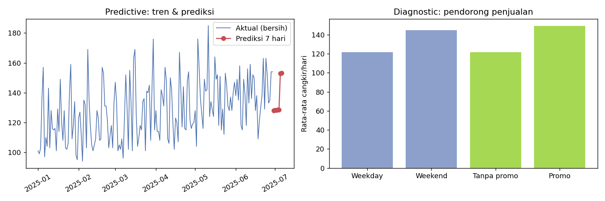
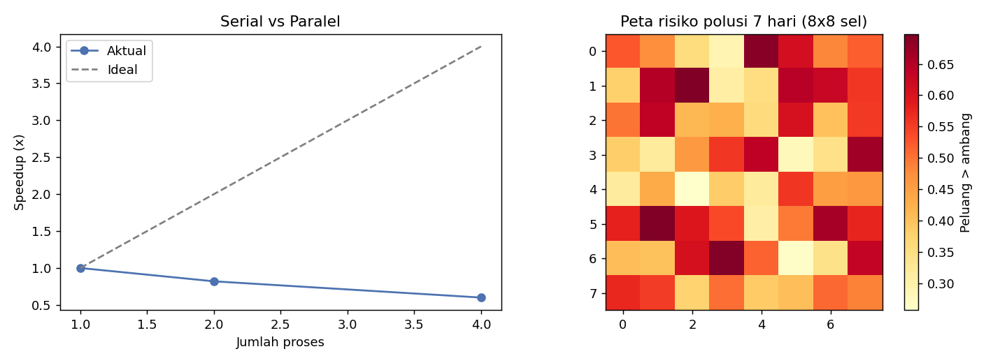
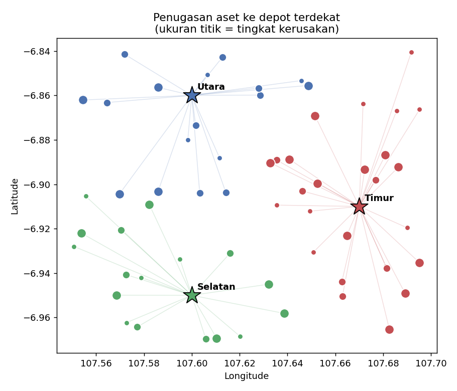
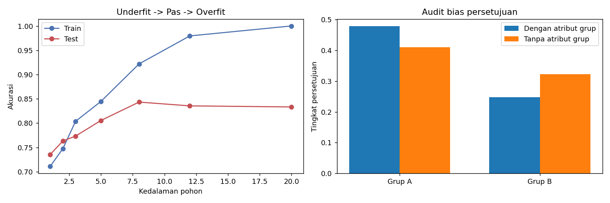
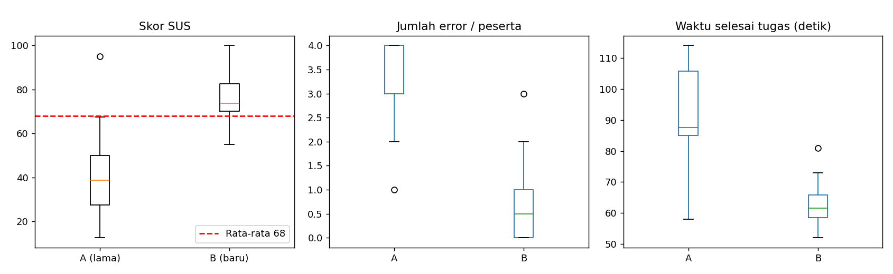
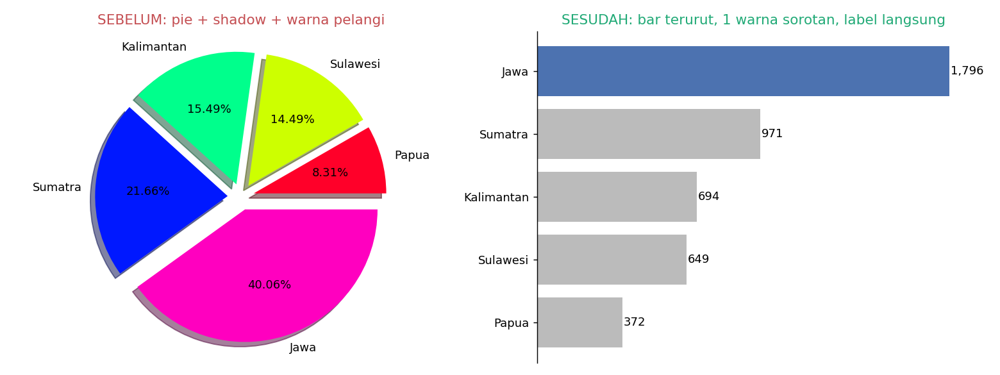
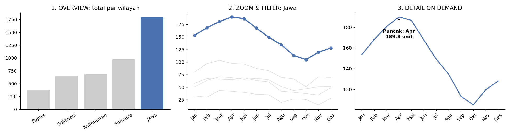

<div align="center">

# 🎓 6 Studi Kasus dari 6 Sesi Webinar Teknologi Informasi

**Analitik Data · HPC · GIS · Machine Learning · IMK · Visualisasi Data**


*Setiap sesi materi diterjemahkan menjadi satu studi kasus kecil, satu skrip Python mandiri, dan satu visualisasi hasil.*

</div>

---

## 📑 Daftar Isi
1. [Tentang Proyek](#-tentang-proyek)
2. [Peta Sesi → Studi Kasus](#-peta-sesi--studi-kasus)
3. [Struktur Folder](#-struktur-folder)
4. [Cara Menjalankan](#-cara-menjalankan)
5. [Studi Kasus 1–6 (ringkasan, batasan masalah, hasil)](#-studi-kasus)
6. [Batasan Umum Proyek](#-batasan-umum-proyek)
7. [Upload ke GitHub](#-upload-ke-github)
8. [Lisensi](#-lisensi)

---

## 🧭 Tentang Proyek

Repositori ini adalah implementasi praktis dari enam sesi materi: **Patterns of Data (BRIN)**, **HPC (Thammasat)**, **GIS di Industri (Selandia Baru)**, **Introduction to Machine Learning (UiTM)**, serta **IMK dan Visualisasi Data**. Tema yang berulang di semua sesi:

> 💡 Mahasiswa TI dituntut berevolusi dari *penulis kode* menjadi **perancang sistem, integrator, dan pemikir kritis** yang paham data, konteks, dan etika.

Karena itu setiap studi kasus tidak hanya menjalankan algoritma, tetapi juga **menyertakan kritik/evaluasi** (data kotor, bias, keterbatasan, usability).

> ⚠️ **Catatan:** ringkasan Sesi 5 dan Sesi 6 pada materi sumber identik (IMK & Visualisasi Data). Agar tidak ada studi kasus kembar, Sesi 5 difokuskan pada **evaluasi usability**, dan Sesi 6 pada **visualisasi data**.

## 🗺️ Peta Sesi → Studi Kasus

| # | Sesi & Pemateri | Konsep Kunci | Studi Kasus | Teknik |
|---|---|---|---|---|
| 1 | Patterns of Data with Analysis & AI — *Andrea Arisal (BRIN)* | Piramida analitik, data preparation 60–70% | Analisis penjualan UMKM kopi dari 4 level analitik | pandas, Linear Regression |
| 2 | Global Infrastructure with HPC — *Dr. Worawan Diaz Carballo* | HPC, percepatan komputasi (22 jam → 45 menit) | Peta risiko polusi udara 7 hari: serial vs paralel | Monte Carlo, `multiprocessing` |
| 3 | Karir & GIS di Industri — *Widi Primadepa* | Mahasiswa TI sebagai developer alat spasial | Penugasan lampu jalan rusak ke depot terdekat + GeoJSON | Haversine, GeoJSON |
| 4 | Introduction to Machine Learning — *Taniza Tajudin (UiTM)* | Overfitting/underfitting, bias data | Persetujuan pinjaman: overfitting & audit bias | Decision Tree, Logistic Regression |
| 5 | IMK — *Evolusi Kognitif Antarmuka* | UCD, Think-Aloud, usability | Evaluasi usability prototipe A vs B | SUS, Welch t-test |
| 6 | IMK & Visualisasi Data | Chartjunk, Overview → Zoom/Filter → Detail | Dasbor penjualan sebelum vs sesudah | Matplotlib |

## 📁 Struktur Folder

```
studi-kasus-6-sesi/
├── README.md                      ← dokumen ini
├── requirements.txt
├── .gitignore
├── LICENSE
├── sesi1_piramida_analitik/       (analisis_kedai.py, hasil.png, output.txt, README.md)
├── sesi2_hpc_paralel/             (simulasi_paralel.py, hasil.png, hasil_benchmark.csv, ...)
├── sesi3_gis_aset/                (gis_aset.py, aset.geojson, hasil.png, ...)
├── sesi4_ml_bias_overfitting/     (ml_pinjaman.py, hasil.png, ...)
├── sesi5_imk_usability/           (evaluasi_sus.py, data_think_aloud.csv, hasil.png, ...)
└── sesi6_visualisasi_data/        (visualisasi.py, 2 gambar, ...)
```

## ▶️ Cara Menjalankan

```bash
# 1. (opsional) buat virtual environment
python -m venv .venv && source .venv/bin/activate      # Windows: .venv\Scripts\activate

# 2. pasang dependensi
pip install -r requirements.txt

# 3. jalankan studi kasus yang diinginkan
python sesi1_piramida_analitik/analisis_kedai.py
python sesi2_hpc_paralel/simulasi_paralel.py
python sesi3_gis_aset/gis_aset.py
python sesi4_ml_bias_overfitting/ml_pinjaman.py
python sesi5_imk_usability/evaluasi_sus.py
python sesi6_visualisasi_data/visualisasi.py
```

Semua skrip memakai **data sintetis** (seed tetap) sehingga hasil dapat direproduksi, tanpa unduhan dataset, dan selesai dalam hitungan detik (Sesi 2 ±20 detik).

---

## 🔬 Studi Kasus

### 1️⃣ Piramida Analitik pada UMKM Kopi
**Latar belakang:** Pemilik kedai ingin memutuskan kapan harus memberi promo. Materi sesi menyebut data berubah menjadi keputusan melalui *Data → Informasi → Insight → Keputusan*, melewati 4 tingkat analitik.

| Tingkat | Pertanyaan | Implementasi |
|---|---|---|
| Descriptive | Apa yang terjadi? | Total & rata-rata penjualan per bulan |
| Diagnostic | Mengapa? | Bandingkan promo vs non-promo, weekday vs weekend |
| Predictive | Apa yang akan terjadi? | Regresi linear, prediksi 7 hari |
| Prescriptive | Apa yang harus dilakukan? | Rekomendasi promo berdasar untung-rugi & kapasitas |

**Batasan masalah:** data sintetis 180 hari satu gerai; model hanya 3 fitur (promo, akhir pekan, tren); tidak memodelkan musiman/cuaca; biaya promo, margin, kapasitas adalah asumsi.

**Hasil:** data preparation menemukan 3 data kosong, 1 nilai negatif, 1 outlier (5000 cangkir). Promo menaikkan rata-rata dari 121,8 → 149,4 cangkir. MAE prediksi 6,42 cangkir. Rekomendasi: **promo di hari kerja, tanpa promo akhir pekan** (kapasitas hampir penuh sehingga promo merugi).



---

### 2️⃣ HPC: Prediksi Risiko Polusi Udara 7 Hari
**Latar belakang:** Sesi HPC menampilkan prediksi kualitas udara Thailand yang dipercepat dari 22 jam menjadi 45 menit. Kasus ini meniru intinya: banyak sel peta dihitung **independen**, sehingga cocok diparalelkan.

**Metode:** untuk tiap sel grid 8×8, 20.000 simulasi *random walk* PM2.5 selama 168 jam; dihitung peluang melewati ambang 55 µg/m³. Dijalankan dengan 1, 2, dan 4 proses.

**Batasan masalah:** model polusi disederhanakan (random walk, bukan fisika atmosfer); benchmark berskala kecil, bukan superkomputer; **speedup bergantung jumlah core CPU** komputer Anda.

**Hasil:** peluang tertinggi 69,8%, rata-rata 48,4%. Lingkungan pembuatan README ini hanya memiliki **1 core CPU**, sehingga proses paralel justru lebih lambat (overhead):

| Proses | Waktu (detik) | Speedup |
|---|---|---|
| 1 | 5,21 | 1,00× |
| 2 | 6,35 | 0,82× |
| 4 | 8,64 | 0,60× |

> 🔎 Ini pelajaran jujur: paralelisme hanya mempercepat jika perangkat keras mendukung. **Di laptop 4+ core, jalankan ulang untuk melihat speedup mendekati 2–4×.**



---

### 3️⃣ GIS: Penugasan Aset Lampu Jalan ke Depot
**Latar belakang:** Sesi GIS menekankan lulusan TI sebagai *developer* alat spasial (Python), bukan sekadar pengguna perangkat lunak berbayar, serta pentingnya format data yang interoperabel (ArcGIS/QGIS/PostGIS).

**Metode:** 60 lampu jalan rusak (koordinat sintetis di kota fiktif) ditugaskan ke dari 3 depot terdekat dengan jarak **Haversine**; prioritas = `kerusakan × 10 − jarak`; hasil diekspor ke **GeoJSON** yang bisa dibuka di QGIS.

**Batasan masalah:** jarak garis lurus (bukan jarak jalan), kapasitas depot tidak dibatasi, tidak ada optimasi rute (TSP), tanpa peta dasar.

**Hasil:** penugasan depot terdekat menghemat jarak dari **478,0 km → 226,3 km** (−52,7%) dibanding semua dikirim dari satu depot. Depot Timur menerima beban terbanyak (26 aset), jadi layak dipertimbangkan penambahan personel.



---

### 4️⃣ Machine Learning: Overfitting & Bias pada Persetujuan Pinjaman
**Latar belakang:** Materi UiTM mengingatkan bahwa model tidak boleh *overfitting*/*underfitting*, dan data historis yang bias menghasilkan keputusan diskriminatif, misalnya pada persetujuan pinjaman.

**Metode:** (A) pohon keputusan dengan kedalaman 1–20; (B) data historis sengaja dibiaskan (30% pemohon layak grup B ditolak) lalu model diaudit dengan **disparate impact ratio** (aturan 80%).

**Batasan masalah:** data sintetis; hanya 2 grup abstrak (A/B); satu metrik keadilan; tidak ada teknik mitigasi lanjut (reweighing, dll.).

**Hasil:**
- Kedalaman 20: train **100%**, test 83,3% → *overfitting*. Kedalaman 1: akurasi rendah → *underfitting*. Terbaik di kedalaman ±8.
- Dengan atribut grup: persetujuan A 47,8% vs B 24,8% → DI **0,52** (bias berat).
- Tanpa atribut grup: DI **0,79**, membaik tetapi **masih di bawah 0,80**, sebab pendapatan bertindak sebagai *proxy*. **Menghapus kolom sensitif belum cukup.**



---

### 5️⃣ IMK: Evaluasi Usability dengan SUS & Think-Aloud
**Latar belakang:** Pendekatan *User-Centered Design* menuntut validasi dengan pengguna nyata. Kasus ini membandingkan prototipe lama (A) dan baru (B).

**Metode:** 12 responden per versi mengisi 10 item **System Usability Scale**; skor dihitung dengan rumus baku (item ganjil −1, genap 5−skor, jumlah × 2,5); dibandingkan dengan uji **Welch t-test**; ditambah data *Think-Aloud* (jumlah error & waktu tugas).

**Batasan masalah:** data sintetis; n = 12 kecil; tidak mencakup evaluasi heuristik pakar maupun aksesibilitas (WCAG).

**Hasil:**

| Prototipe | SUS | Kategori | Error/peserta | Waktu tugas |
|---|---|---|---|---|
| A (lama) | 41,2 | Awful | 3,1 | 92,3 s |
| B (baru) | 76,9 | Good | 0,8 | 63,1 s |

Welch t-test: t = 4,60, **p = 0,0002** → perbedaan signifikan. Prototipe B melewati rata-rata benchmark 68.



---

### 6️⃣ Visualisasi Data: Hapus Chartjunk & Overview → Zoom/Filter → Detail
**Latar belakang:** Materi menekankan pemilihan grafik yang tepat, menghapus *chartjunk*, dan mantra interaksi visual untuk menurunkan beban kognitif.

**Metode:** (1) pie 3D-ish berwarna pelangi diganti bar terurut satu warna sorotan dengan label langsung; (2) dasbor 3 panel: **Overview** (total per wilayah), **Zoom & Filter** (wilayah teratas, lainnya diredam abu-abu), **Detail on demand** (anotasi puncak).

**Batasan masalah:** gambar statis (bukan dasbor interaktif sungguhan); data penjualan sintetis 5 wilayah × 12 bulan.

**Hasil:** Jawa mendominasi (1.796 unit, ±40%); puncak penjualan Jawa terjadi di **April (189,8 unit)**.




---

## 🚧 Batasan Umum Proyek
- Semua data **sintetis** untuk tujuan edukasi; angka bukan fakta lapangan.
- Kode sengaja **sederhana & ringan** (satu berkas per studi kasus, tanpa GPU/dataset besar).
- Model bersifat ilustratif, bukan untuk produksi.
- Angka README berasal dari satu kali eksekusi dengan *seed* tetap; versi library berbeda dapat memberi selisih kecil.

## 🚀 Upload ke GitHub

```bash
cd studi-kasus-6-sesi
git init
git add .
git commit -m "feat: 6 studi kasus dari 6 sesi webinar TI"
git branch -M main
git remote add origin https://github.com/<username>/studi-kasus-6-sesi.git
git push -u origin main
```
(Buat dulu repo kosong bernama `studi-kasus-6-sesi` di github.com/new.)

## 📄 Lisensi
MIT, bebas dipakai untuk belajar dan dikembangkan.
